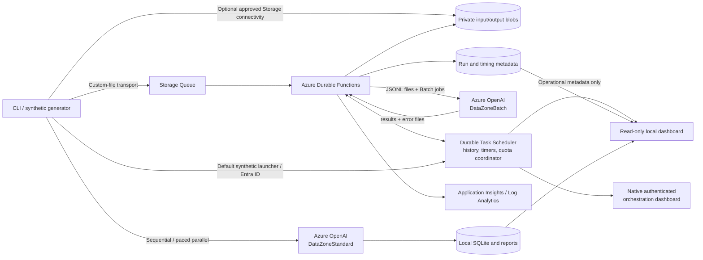
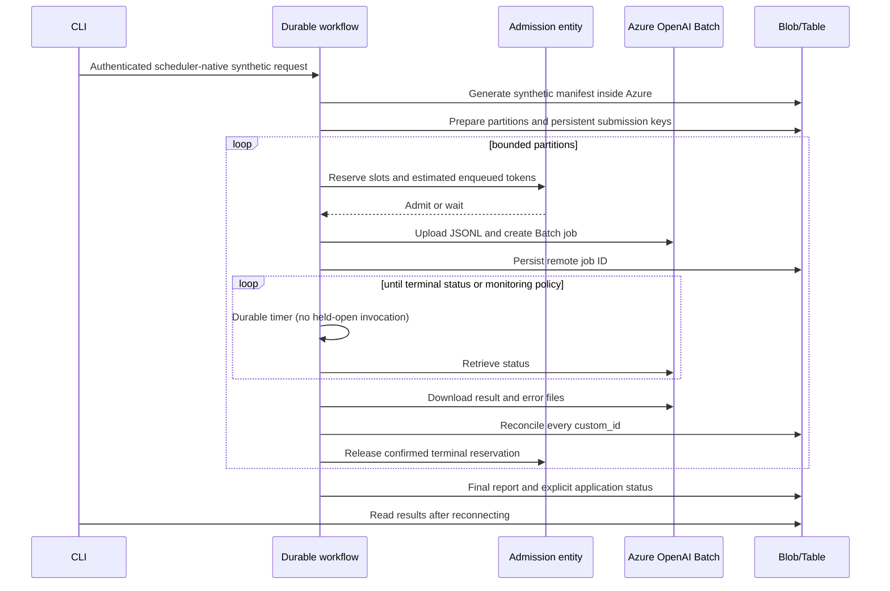

# Architecture

All regional resources use the environment's location, defaulting to
`southcentralus`. Azure OpenAI inference is scoped to the **US Data Zone**,
which is broader than a single region.

## Cloud execution sequence

## Important boundaries

- Workflow inputs contain IDs/references, not full documents or credentials.
- Model calls live in activities, not replayed orchestrator code.
- The runtime uses managed identity. Local clients use an explicitly selected
  Azure CLI identity. No administrator password or API key is embedded.
- The shared cloud coordinator governs this application/task hub. It does not
  govern unrelated applications consuming the same Azure quota.
- Local SQLite is not used as distributed cloud state. The local scheduler
  registry only remembers submitted IDs and cached operational metadata.
- Submission timeout is an **ambiguous write**, not permission to create another
  paid job. Reconcile matching remote metadata first.
- Storage endpoints are protected by an enforced Network Security Perimeter:
  one approved client address and subscription-based managed-identity traffic.
  This adds a network gate without removing data-plane authorization.
- No policy-exclusion tag or unrestricted client range is required. Production
  private-IP isolation still needs an additional reviewed design.

The default synthetic launcher does not need external Storage access. Custom
input/output files continue to require authorized Storage connectivity. The
scheduler path returns operational reports, not the contents of private documents.

An editable source diagram is included as `architecture.excalidraw`.

## V4 online routing on the same durable foundation

`multi_deployment_workflow` creates a synthetic manifest in Azure, acquires
the `multi_router` entity lease, and runs five child orchestrations for the
single-target arm. After reconciliation and a 65-second durable pause, it
runs the same five-worker layout against the three-target pool. Both arms
have 150K TPM / 150 RPM aggregate. This is separate from the Batch sequence
above; it calls online DataZoneStandard deployments, not the Batch API.

The entity serializes target selection, per-target cooldowns, attempt/cost
reservations, and the original stage deadline. Activities persist an atomic
request intent before inference and a response before reconciliation.
Re-delivery uses saved responses; uncertain outcomes remain explicit and
keep the routing lease held. Private Blob/Table state survives a local
observer disconnect.

The new model template adds only three 50K model children to the existing
account. The control and v1/v2 model deployments remain unchanged; no new
subscription, region, identity, network exception, or PTU is introduced.
See the [v4 guide](v4-multi-deployment.md) for boundaries and operations.
The editable base diagram remains the v1/v2 Batch topology, not a drawing
of the v4 routing pool.
