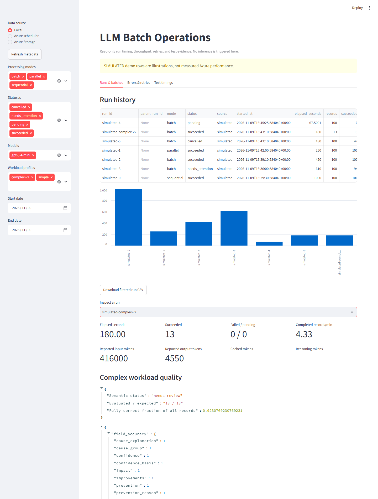

# V2: complex synthetic prompts and load scenarios

Version **0.2.0** adds an opt-in `complex-v2` workload. The original `simple`
profile remains the default. V2 tests semantic and rule-following complexity,
not just the token volume of repeated reference text.

The domain, taxonomy, examples, conversations, identifiers, and grading rules
are independently authored fiction. They reproduce structural challenges
without copying a customer's policies, wording, business labels, or records.
This is not a claim that the benchmark matches any production workload's
accuracy, reasoning difficulty, or latency.

See the [measured v2 results](complex-v2-validation.md): all outputs processed,
but the original acceptance gates failed. The benchmark reports these model
errors instead of presenting schema validity as correctness.

## The actual prompts are Markdown files

| File in `prompts` | Runtime use |
|---|---|
| `simple-v1.md` | Original short baseline system prompt, unchanged in meaning and bytes after trimming. |
| `complex-system-v2.md` | Evidence hierarchy, eleven-field contract, confidence rules, consistency checks, and identifier suppression. |
| `complex-taxonomy-v2.md` | Active catalog of **425 routes and 850 examples**, not ignored filler. |
| `complex-user-v2.md` | Instructions placed before each generated input record. |

The complex system message is the system Markdown plus the taxonomy Markdown.
The user message is the user Markdown plus **one** generated conversation and
its archived classification. Ground-truth labels are retained for evaluation
but are **never sent in the API request**.

Every source archive, wheel, and Functions package includes these Markdown
assets. The deployment hook checks their hashes. The client sends a bundle hash
covering the system prompt, taxonomy, user instructions, and output schema;
the cloud worker rejects a mismatch before submitting inference.

For local runs, inspect `outputs\runs\RUN_ID\prompt.md`, `input.jsonl`, and
`config.json`. Cloud runs keep equivalent `prompt.md` and `manifest.json`
artifacts in private Blob Storage. The scheduler view returns metadata and
quality scores, not raw records.

## What makes the workload complex

The catalog contains 17 fictional service domains, five services per domain,
and five potentially confusable goals per service: instructions, requirements,
progress, fault, and dispute. Selection depends on context and requested action,
not just the service noun.

The default 13-case suite contains one example of each family:

| Family | Challenge |
|---|---|
| Direct need | Preserve an existing high-confidence score and its explanation. |
| Stale candidate | Correct the route while retaining an immutable archived confidence. |
| Menu distraction | Ignore irrelevant service options and verification exchanges. |
| Negated intent | Do not classify a goal the caller explicitly rejects. |
| Corrected goal | Use a later correction rather than the retracted request. |
| Secondary topics | Return distinct, meaningfully handled additional needs. |
| Insufficient source | Use the explicit no-actionable-evidence path. |
| Partial evidence | Preserve supported fields without inventing unknown causes or impact. |
| Unresolved handoff | Do not turn a transfer into a completed outcome. |
| Ambiguous tie | Apply the archived candidate only as the documented tie-breaker. |
| Confidence upgrade | Raise a low score only into the evidence-supported band. |
| Instruction in data | Treat quoted instruction-like text as data and omit synthetic canaries. |
| Partial outcome | Distinguish the primary request's completion from an unfinished secondary need. |

The synthetic preservation threshold is **75**, deliberately chosen for this
independent benchmark. Scores are rubric values, not calibrated probabilities.
The response has eleven fields; the application adds the record ID to make a
twelve-column `analysis.csv`.

The assembled seed-42 smoke requests contain approximately **32,300-32,600
estimated input tokens** each, plus a 2,048-token output ceiling. This is active
taxonomy/rule content, not the earlier ~74.5K filler-based stress profile.
The two profiles test different things and must not be presented as a
same-token comparison.

Thirteen cases exercise all scenario families, **not all 425 routes**. Increase
coverage deliberately and review the token/cost estimate before larger tests.

## Preview without Azure calls

Install the source as described in the README, then:

```powershell
llm-batch generate --profile complex-v2 --count 13 --seed 42 --output outputs\complex-v2.jsonl
llm-batch prepare outputs\complex-v2.jsonl --profile complex-v2 --output outputs\complex-prepared
llm-batch load-test --scenario scenarios\complex-v2-smoke.json --config .azure\demo-config.json
```

`load-test` is a **dry run unless `--yes` is supplied**. It reports the active
prompt hash, estimated input range, stages, partitions, generation parameters,
and a conservative inference estimate including configured online retries.
It does not sign in, submit jobs, or run inference in preview mode.

Complex gold-labeled records cannot accidentally run against the simple output
schema. Token-padding options are intentionally rejected for `complex-v2`;
use the original `simple` profile for isolated token-volume experiments.

## Execute the bounded same-data comparison

First deploy the v2 code using the [Azure tutorial](azure-demo.md). Review your
private configuration's `rpm`, `tpm`, `max_attempts`, and `max_run_cost_usd`.
Leave headroom below the deployment's actual limits. A low client TPM limit
can flatten throughput even when the service has more capacity.

```powershell
llm-batch load-test --scenario scenarios\complex-v2-smoke.json --config .azure\demo-config.json --yes
```

The smoke scenario uses the same seed, thirteen records, prompt/schema bundle,
model configuration, low reasoning effort, and 2,048-token generation ceiling
for sequential online, five-worker online, and **Azure-hosted actual Batch**.
It uses one coordinated online limiter and 65-second cooldowns between stages.

The three-stage estimate with the example rates is approximately USD 3.13
including the configured online attempt ceiling. Actual cost can differ.
Infrastructure costs are separate; an estimate is not a billing cap.

The second scenario compares one, two, and five workers on 26 records:

```powershell
llm-batch load-test --scenario scenarios\complex-v2-concurrency.json --config .azure\demo-config.json
```

It is a separate, larger experiment. Review its preview before adding `--yes`.
Do not silently expand the smoke test into a 1,700-record complex run.

These are bounded paced comparisons, not sustained-capacity certifications.
To observe throttling deliberately on an authorized dedicated endpoint, the
existing stress runner also accepts the active complex prompt:

```powershell
python scripts\stress.py --profile complex-v2 --config .azure\demo-config.json --count 6 --concurrency 5 --observe-service-throttling --yes
```

That command is separately opt-in, uses one attempt per record, and may produce
failed records. It does not change model capacity.

## Individual local and cloud commands

```powershell
llm-batch run outputs\complex-v2.jsonl --profile complex-v2 --mode parallel --config .azure\demo-config.json
llm-batch run outputs\complex-v2.jsonl --profile complex-v2 --mode batch --config .azure\demo-config.json
llm-batch azure-demo --profile complex-v2 --count 13 --seed 42 --config .azure\demo-config.json
llm-batch azure-status RUN_ID --config .azure\demo-config.json --wait
```

Local `--mode batch` uses the real Batch API with a local observer. The
`azure-demo` command and a load matrix's Batch stage use the deployed Durable
workflow, which continues if the local observer disconnects.

## Read the results honestly

The load runner writes a private `outputs\load-tests\SCENARIO-ID\matrix.json`
before and throughout execution. Each stage has its saved run ID, processing
status, quality gate, and full summary.

- Processing `succeeded` means valid, reconciled output for every record.
- `semantic_status` and `quality` separately describe field accuracy,
  constraint compliance, evaluated coverage, and scenario-level results.
- The fully-correct fraction uses **all expected records** as its denominator;
  failed or unevaluated records do not disappear from the quality report.
- Free-form new confidence explanations are checked for presence and canary
  suppression, not independently judged for semantic truth.
- The default matrix gate requires complete processing/evaluation, at least
  80% primary-route accuracy, 100% confidence-rubric compliance, preservation
  of immutable archived confidence, and no identifier-canary leakage.
  A passing gate does **not** imply every output field is correct.

The load command exits `0` for a passed gate, `1` for failure/quality review,
and `2` while cloud work remains pending. Model mistakes are reported, not
replaced with the expected answer or automatically retried as transport errors.

Refresh a pending saved cloud stage without submitting again:

```powershell
llm-batch load-test-refresh outputs\load-tests\SCENARIO-ID\matrix.json
```

The end-to-end matrix time includes cooldowns and observation. Individual
stage summaries keep HTTP latency separate from Batch queue/turnaround time.
Do not extrapolate a thirteen-record burst into a sustained records/minute SLA.

If execution was interrupted, inspect the saved run IDs first. Use the existing
`resume`, `azure-status`, or investigated `azure-recover` path as appropriate.
Starting `load-test --yes` again creates **new paid runs**; it is not resume.

## Dashboard and customization

```powershell
llm-batch dashboard --demo
llm-batch dashboard --config .azure\demo-config.json
```

Filter **Workload profiles** to `complex-v2` and inspect **Complex workload
quality**. The offline fixture intentionally has one semantic error despite
all thirteen records being schema-valid, and is prominently labeled SIMULATED.



Edit the system/user Markdown to create a different experiment. Taxonomy
Markdown is generated from the independent catalog in `complex_workload.py`;
change that catalog and run `python scripts\build-complex-catalog.py` rather
than silently letting text and gold labels disagree. Adjust gold rules and
tests when changing the output contract or scoring rubric.

Keep previous run snapshots for comparisons, redeploy changed assets, and
verify the new prompt hash. Neither synthetic scoring nor load testing proves
that a modified real-world prompt is accurate or appropriate for production.
